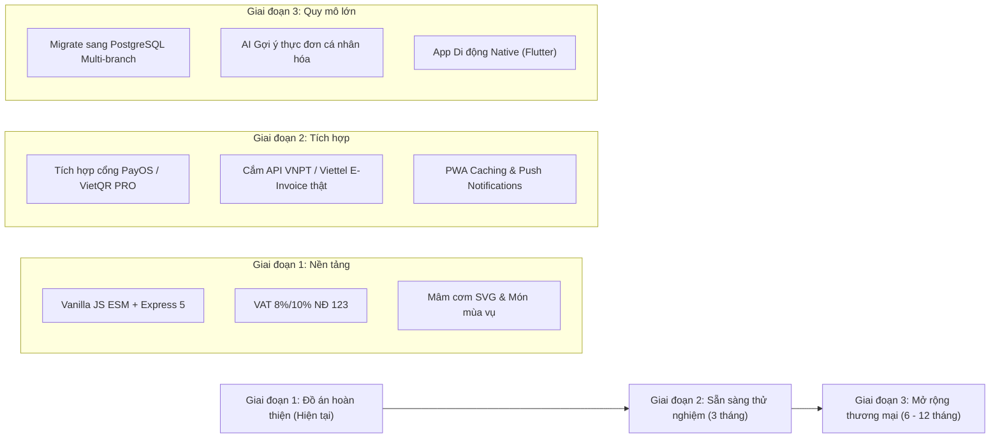

# BÁO CÁO CÁC GIỚI HẠN VÀ HƯỚNG PHÁT TRIỂN (LIMITATIONS & ROADMAP)
## HỆ THỐNG WEBSITE NHÀ HÀNG "VỊ NHÀ MÌNH"

> **Mục đích**: Tuyên bố trung thực, minh bạch về mặt học thuật và kỹ thuật đối với phạm vi nghiên cứu của đồ án, đồng thời đề xuất lộ trình mở rộng nâng cấp trong môi trường sản xuất thực tế (Production).

---

## 🔍 1. DANH SÁCH CÁC GIỚI HẠN KỸ THUẬT HIỆN TẠI (LIMITATIONS)

### 1.1. Hệ thống Hóa đơn điện tử (E-Invoice System)
* **Thực trạng**: Hệ thống đã hoàn thiện 100% thuật toán nghiệp vụ bóc tách thuế GTGT 2 mức (8% và 10%), cấp số hóa đơn tuần tự chống trùng lặp trong SQLite transaction, kiểm tra Mã số thuế (MST) theo giải thuật Modulo 11 và sinh bản thể hiện HĐĐT chuẩn Nghị định 123/2020/NĐ-CP kèm QR tra cứu và watermark bảo vệ pháp lý.
* **Giới hạn**: Hệ thống hiện chạy qua **Adapter DEMO** cục bộ. Chưa thực hiện truyền nhận dữ liệu trực tiếp qua API ký số HSM (Hardware Security Module) hoặc USB Token với các nhà mạng được Tổng cục Thuế ủy quyền (như VNPT Invoice, Viettel Sinvoice, MISA meInvoice).
* **Lý do**: Yêu cầu pháp nhân doanh nghiệp thực tế, hợp đồng thương mại với nhà cung cấp dịch vụ và chứng thư số hợp lệ có đăng ký với Cơ quan Thuế.
* **Biện pháp xử lý**: Đã kiến trúc sẵn mẫu thiết kế **Adapter Pattern** tại `server/services/einvoice/`. Khi có thông tin tài khoản thật, chỉ cần điền thông số API vào adapter tương ứng mà không phải can thiệp vào logic tính toán nghiệp vụ lõi.

---

### 1.2. Cổng Thanh toán Trực tuyến (Payment Gateway)
* **Thực trạng**: Hệ thống cung cấp luồng thanh toán chuyển khoản ngân hàng qua mã VietQR và mô phỏng giao dịch thẻ ATM/Visa/Mastercard theo chuẩn Sandbox.
* **Giới hạn**: Chưa tích hợp cơ chế Webhook IPN (Instant Payment Notification) tự động gạch nợ ngân hàng thời gian thực từ các cổng thanh toán trung gian như VNPay, MoMo, ZaloPay, PayOS.
* **Lý do**: Các cổng thanh toán này yêu cầu hồ sơ doanh nghiệp hoặc hộ kinh doanh cá thể được cấp phép để mở cổng thanh toán thật.
* **Biện pháp xử lý**: Nhân viên thu ngân/admin có thể kiểm tra biến động số dư và bấm nút xác nhận trạng thái đơn thủ công trên giao diện Quản trị.

---

### 1.3. Cơ sở dữ liệu và Khả năng mở rộng đa chi nhánh (Scalability)
* **Thực trạng**: Sử dụng CSDL quan hệ **SQLite3** có versioning migration. SQLite mang lại tốc độ truy vấn cục bộ cực nhanh, không tốn tài nguyên máy chủ và dễ dàng đóng gói nộp đồ án.
* **Giới hạn**: SQLite khóa toàn bộ tệp tin khi thực hiện thao tác ghi (Write Lock). Với mô hình chuỗi nhiều nhà hàng quy mô lớn (hàng chục nghìn lượt truy cập và hàng trăm giao dịch ghi mỗi giây), SQLite có thể gặp hiện tượng nghẽn cổ chai (lock contention).
* **Giải pháp tương lai**: Chuyển đổi tầng truy xuất dữ liệu sang **PostgreSQL** kết hợp Connection Pooling (PgBouncer) và Redis Cache cho giỏ hàng/thực đơn khi đưa vào vận hành chuỗi thương mại lớn.

---

### 1.4. Mức độ Kiểm thử Thiết bị vật lý (Physical Device Testing)
* **Thực trạng**: Giao diện đã được kiểm thử tự động bằng unit test cấu trúc và kiểm thử giả lập Responsive trên DevTools ở 6 dải màn hình chuẩn (360px, 390px, 768px, 1024px, 1280px, 1536px), CSS đã bổ sung các fallback `@supports not` và vendor prefix `-webkit-`.
* **Giới hạn**: Nhóm chưa có điều kiện thử nghiệm thực tế trên toàn bộ danh mục thiết bị phần cứng vật lý cũ (như iPhone 6/7 chạy Safari 12–13, các dòng máy Android đời cũ sử dụng trình duyệt nội địa đặc thù).
* **Cam kết trung thực**: Đã công bố bản tuyên bố miễn trừ trách nhiệm (Disclaimer) rõ ràng trong tài liệu `docs/BROWSER_MATRIX.md`.

---

### 1.5. Trải nghiệm Ứng dụng Di động Ngoại tuyến (PWA / Offline Support)
* **Thực trạng**: Website được tối ưu Mobile-first, hỗ trợ cảm ứng vuốt chạm, tap target ≥ 44px, modal co thành bottom sheet.
* **Giới hạn**: Chưa cài đặt Service Worker để lưu cache toàn diện cho kịch bản mất mạng hoàn toàn (Offline-first PWA), chưa hỗ trợ Push Notification gốc qua Firebase Cloud Messaging (FCM).

---

## 🚀 2. LỘ TRÌNH PHÁT TRIỂN VÀ NÂNG CẤP (PRODUCT ROADMAP)

### Chi tiết các mốc mở rộng:
1. **Quý 1 (Tích hợp thanh toán & Hóa đơn thật)**:
   - Đăng ký tài khoản doanh nghiệp PayOS / VNPay để nhận Webhook xác thực giao dịch tức thì.
   - Ký kết dịch vụ phát hành hóa đơn điện tử với VNPT/Viettel để kích hoạt adapter chính thức.
2. **Quý 2 (Nâng cao trải nghiệm PWA & Khách hàng thân thiết)**:
   - Tích hợp `manifest.webmanifest` và Workbox Service Worker để khách hàng cài đặt app lên màn hình chính (A2HS).
   - Hệ thống thông báo đẩy (Web Push Notifications) nhắc nhở bàn đặt và món mới vào mùa vụ.
3. **Quý 3 & 4 (Hạ tầng Enterprise & Đa chi nhánh)**:
   - Tách biệt kiến trúc Microservices hoặc Module hóa sâu với PostgreSQL, quản lý tồn kho và doanh thu đồng bộ giữa các chi nhánh tại Cần Thơ, TP.HCM, Vĩnh Long.
   - Xây dựng ứng dụng di động dành cho nhân viên phục vụ trên nền tảng Flutter.

---

## 📝 3. KẾT LUẬN

Những giới hạn trên hoàn toàn nằm trong phạm vi dự tính của một đồ án công nghệ thông tin định hướng chuẩn hóa chuyên môn. Toàn bộ kiến trúc phần mềm đã được thiết kế mở (Open-Closed Principle), phân tách tầng rõ ràng, đảm bảo việc nâng cấp tích hợp các dịch vụ bên ngoài trong tương lai diễn ra thuận lợi mà không làm phá vỡ logic sẵn có.
