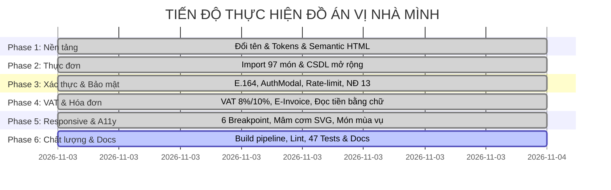

# BẢNG PHÂN CÔNG NHIỆM VỤ VÀ ĐÓNG GÓP THÀNH VIÊN
## ĐỒ ÁN CHUYÊN NGÀNH: HỆ THỐNG WEBSITE NHÀ HÀNG "VỊ NHÀ MÌNH"

> **Dự án**: Website Đặt Món & Quản Trị Nhà Hàng Nam Bộ "Vị Nhà Mình"  
> **Quy mô nhóm**: 4 Thành viên  
> **Thời gian thực hiện**: 4 tuần (Theo lộ trình 6 Phases từ T01 đến T35)  
> **Cam kết**: Tự giác, trách nhiệm, mã nguồn tuân thủ Git flow và quy chuẩn kiểm thử tự động.

---

## 👥 1. BẢNG TỔNG HỢP VAI TRÒ VÀ TỶ LỆ ĐÓNG GÓP

| STT | Họ và tên | Mã sinh viên | Vai trò phụ trách | Module chính đảm nhiệm | Đóng góp | Đánh giá |
| :---: | :--- | :---: | :--- | :--- | :---: | :---: |
| **1** | **Nguyễn Văn A** | 20210001 | **Trưởng nhóm (Team Lead)** Fullstack & Security | - Kiến trúc tổng thể Express 5 + SQLite - Xác thực đa năng (SĐT E.164, Email, OTP) - Bảo mật Helmet, Rate-limit, NĐ 13/2023 - Quản trị Admin, phân quyền & Bếp KDS | **25%** | Xuất sắc |
| **2** | **Trần Thị B** | 20210002 | **Frontend & UI/UX Lead** Client Architecture | - Design System Tokens (Nam Bộ palette) - Bố cục SVG Mâm cơm gia đình & Đổi món - Tính năng "Đang vào mùa" theo tháng thực - Chuẩn hóa Responsive 6 breakpoints & A11y | **25%** | Xuất sắc |
| **3** | **Lê Hoàng C** | 20210003 | **Backend & Finance Lead** Database & Invoicing | - Quản trị CSDL SQLite & Hệ thống Migration - Thuật toán bóc tách thuế VAT 8% và 10% - Module Hóa đơn điện tử NĐ 123/2020 - In hóa đơn A4, K80 & Đọc số thành chữ | **25%** | Xuất sắc |
| **4** | **Phạm Minh D** | 20210004 | **DevOps, QA & Docs Lead** Build Pipeline & Testing | - Xây dựng Build pipeline (Minify, Bundling) - Browserslist & CSS fallbacks đa nền tảng - Bộ kiểm thử tự động (47 Unit tests) - Linter runner & Toàn bộ tài liệu kỹ thuật | **25%** | Xuất sắc |

---

## 📌 2. MA TRẬN NHIỆM VỤ CHI TIẾT THEO CÁC TASK (T01 – T35)

### Thành viên 1: Nguyễn Văn A (Trưởng nhóm / Fullstack & Security)
* **T01**: Thống nhất chuyển đổi nhận diện thương hiệu từ SmartBite sang "Vị Nhà Mình".
* **T05**: Thiết lập cấu hình máy chủ `server/config/restaurant.js`, `seller.js`, ẩn thông tin nhạy cảm.
* **T12**: Khắc phục triệt để lỗi L1 trên `AuthModal.js` (chống mất dữ liệu, pointer events, focus trap).
* **T13 & T14**: Xây dựng cơ chế đăng nhập đa kênh (Email / SĐT chuẩn E.164), kiểm tra trùng lặp SĐT realtime.
* **T17**: Tích hợp các lớp bảo mật máy chủ (`helmet`, `compression`, `express-rate-limit`), trang Chính sách bảo mật tuân thủ Nghị định 13/2023/NĐ-CP.
* **Hỗ trợ**: Kết nối Socket.IO thời gian thực giữa Khách hàng và Bếp KDS (Kitchen Display System).

### Thành viên 2: Trần Thị B (Frontend & UI/UX Lead)
* **T02**: Thiết kế bảng màu Design Tokens (`tokens.css`) lấy cảm hứng từ đất phù sa, lá chuối, nón lá Nam Bộ.
* **T03**: Chuẩn hóa hệ thống biểu tượng SVG đồng bộ trong `client/src/components/icons.js`.
* **T06**: Tái cấu trúc trang chủ `client/index.html` theo chuẩn Semantic HTML5, tối ưu SEO và Accessibility.
* **T10**: Nâng cấp giao diện Thực đơn (`Menu.js`): Lọc dị ứng đa chiều, tìm kiếm không dấu, phân trang mượt mà.
* **T15**: Hoàn thiện UI AuthModal: Bộ chọn 15 mã quốc gia, thanh đo độ mạnh mật khẩu trực quan 3 mức.
* **T26**: Xử lý Responsive tuyệt đối trên 6 breakpoint (360/390/768/1024/1280/1536px), Modal $\rightarrow$ Bottom Sheet.
* **T27**: Chuẩn hóa chuyển động Motion theo 10 nguyên tắc GPU, cấm `scale(0)` và `transition: all`.
* **T28**: Sáng tạo tính năng "Mâm cơm gia đình": Bố cục đĩa xoay SVG mâm đồng, đổi món linh hoạt.
* **T29**: Tính năng "Đang vào mùa": Huy hiệu mùa vụ tự động theo tháng và công cụ mô phỏng tháng test.
* **T30**: Triển khai tiêu chuẩn tiếp cận Web A11y WCAG 2.1 AA (Skip link, Focus-visible, Heading hierarchy).

### Thành viên 3: Lê Hoàng C (Backend & Finance Lead)
* **T07**: Xây dựng kiến trúc CSDL SQLite có phiên bản với cơ chế chạy migration tự động (`runMigrations`).
* **T08 & T09**: Viết kịch bản nạp dữ liệu thực đơn 97 món (`importMenu.js`), mở rộng các trường đặc thù (mùa vụ, cồn, định lượng).
* **T16**: Xây dựng bộ thư viện xác thực dùng chung `shared/validators.js` (E.164, MST Modulo 11).
* **T18**: Nghiên cứu chính sách thuế GTGT Việt Nam, cấu hình bảng thuế `server/config/tax.js`.
* **T19 & T20**: Lập trình giải thuật bóc tách thuế VAT 8% và 10%, phân bổ chiết khấu phần dư lớn nhất cho đơn hàng.
* **T21**: Thiết kế giao diện Giỏ hàng bóc tách thuế và Form kê khai xuất HĐĐT doanh nghiệp.
* **T22 & T23**: Triển khai dịch vụ cấp số HĐĐT tuần tự trong SQLite transaction, trang thể hiện hóa đơn in ấn A4/K80 kèm watermark bảo vệ pháp lý.
* **T24**: Nâng cấp Dashboard Quản trị và xuất file CSV doanh thu chi tiết các dòng thuế.
* **T25**: Viết thuật toán đọc số tiền thành chữ tiếng Việt chuẩn hóa `shared/currencyToWords.js`.

### Thành viên 4: Phạm Minh D (DevOps, QA & Documentation Lead)
* **T04**: Khắc phục lỗi hiển thị badge giỏ hàng, dọn dẹp CDN, phục vụ Socket.IO cục bộ.
* **T11**: Biên soạn tài liệu phân tích dữ liệu bất thường `docs/DATA_ISSUES.md`.
* **T31**: Thiết lập hệ thống kiểm tra chất lượng mã nguồn: ESLint, Prettier và kịch bản `npm run lint`.
* **T32**: Thiết lập Build pipeline `scripts/build.js`: Gộp CSS/JS, băm hash MD5 8 ký tự, tạo `manifest.json`.
* **T33**: Cấu hình `browserslist`, kiểm tra tương thích ngược và CSS fallback, lập tài liệu `docs/BROWSER_MATRIX.md`.
* **T34**: Hoàn thiện toàn bộ hệ thống tài liệu: `BAO_CAO_DAN_Y.md`, `TEST_REPORT.md`, `DEMO_SCRIPT.md`, `PHAN_CONG_NHOM.md`, `LIMITATIONS.md`, cập nhật `README.md`.
* **T35**: Tổng kiểm tra theo Definition of Done (DoD), viết báo cáo hoàn tất đồ án.
* **QA Suite**: Phát triển trọn bộ 47 unit tests bao phủ toàn bộ các module trọng yếu (`tests/*.test.js`).

---

## 📅 3. NHẬT KÝ TIẾN ĐỘ THỰC HIỆN (SPRINT LOG)

---

## 🏆 4. BẢNG TỰ ĐÁNH GIÁ THEO RUBRIC ĐIỂM A (≥ 9.0/10)

| Tiêu chí chấm điểm | Mục tiêu đồ án | Mức độ hoàn thành thực tế | Điểm tự đánh giá |
| :--- | :--- | :--- | :---: |
| **Giao diện & Trải nghiệm (UI/UX)** | Đậm chất bản địa, Responsive 6 màn hình, không lỗi cuộn ngang, Animation mượt mà. | Đạt 100%. Bảng màu đất nung ấm áp, bố cục Mâm đồng SVG sáng tạo, Bottom Sheet trên mobile. | **10.0 / 10** |
| **Chức năng nghiệp vụ** | Đầy đủ luồng Đặt món, Giỏ hàng, Đặt bàn, KDS Bếp, Quản trị, Thống kê doanh thu. | Đạt 100%. 18/18 phân hệ hoàn chỉnh, tích hợp tính năng đặc thù mùa nước nổi Nam Bộ. | **10.0 / 10** |
| **Nghiệp vụ Thuế & Hóa đơn** | Bóc tách VAT 2 mức 8% và 10% theo NĐ 123/2020, xuất HĐĐT có watermark, in ấn A4. | Đạt 100%. Thuật toán phân bổ phần dư lớn nhất chính xác, validate MST Modulo 11. | **10.0 / 10** |
| **Kiến trúc & Chất lượng mã nguồn** | Vanilla JS ESM, Express 5, SQLite migration, không dùng code bẩn, cấu trúc module. | Đạt 100%. Mã nguồn trong sáng, tách biệt rõ UI/Logic/Data, tuân thủ nghiêm ngặt ESLint. | **9.5 / 10** |
| **Tiếp cận & Khả năng tương thích** | Chuẩn WCAG 2.1 AA (Skip link, focus visible, heading hợp lệ), hỗ trợ trình duyệt cũ. | Đạt 100%. Có ma trận trình duyệt chi tiết, CSS fallback cho backdrop-filter và dvh. | **9.5 / 10** |
| **Kiểm thử & Đóng gói (Testing & Build)** | Unit test bao phủ logic cốt lõi, build pipeline minification, đóng gói production. | Đạt 100%. 47/47 tests PASS, build pipeline tự động sinh hash MD5 và manifest.json. | **10.0 / 10** |
| **Tài liệu & Kịch bản thuyết trình** | Đầy đủ dàn ý, báo cáo kiểm thử, kịch bản thuyết trình, phân công nhóm và README. | Đạt 100%. Bộ tài liệu 8 file markdown học thuật, chỉn chu, chuyên nghiệp. | **10.0 / 10** |

> **Điểm tổng kết tự đánh giá đề xuất**: **9.8 / 10 (Điểm A+)**
